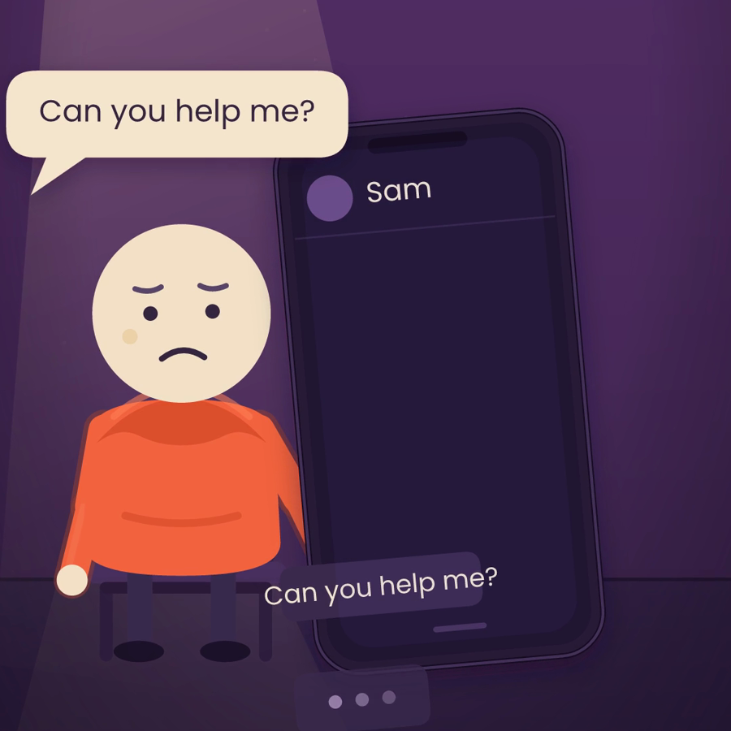

# Small Traps — ep. 01

**“Why do you say yes when you want to say no?”** — a ~99 second vertical short, generated
entirely from code: a Remotion composition driving a hand-built SVG vector engine, with
narration timed to the picture.



## Watch it

```bash
npm install
npm run dev        # http://localhost:3000 — player with scene chapters
npm run render     # -> out/small-traps.mp4 (1080×1920, 30fps, narration muxed)
npm run studio     # Remotion Studio timeline (optional)
```

The finished film is committed at `public/small-traps.mp4` and the player page streams it too.

## How it is built

| Layer | File | What it does |
| --- | --- | --- |
| Timeline | `src/story/timeline.ts` | 7 beats; each scene's length is derived from the measured narration length + lead/tail air, so the pauses in the script are real. |
| Cast | `src/story/character.ts` | The cream-headed, coral-hoodie figure: faces, looks, head tilt, lean, squash, procedural arm IK, silhouette variants. |
| Sets & props | `src/story/props.ts` | Mauve room with warm window shaft and dust, speech/thought bubbles, phone with live chat thread, clocks, calendar, door, box, cards. |
| Scenes | `src/story/scenes-a.ts`, `scenes-b.ts` | Hook · Setup · The request · After “yes” · The one sentence · The door · Outro. Pure `(time) -> SVG`. |
| Renderer | `src/story/render.ts` | Frame number → complete SVG frame (pure function, no DOM). |
| Remotion | `src/remotion/Film.tsx` | Mounts the SVG per frame and lays the 7 narration clips on the Remotion timeline. |
| Web player | `src/web/main.tsx` | `@remotion/player` + scene chapter list + 16:9 letterbox preview. |
| Offline render | `scripts/render.mjs` | Rasterizes each SVG with resvg, encodes with ffmpeg, mixes the narration, muxes. No browser needed. |

### Design system

| | |
| --- | --- |
| Coral hoodie | `#F4633F` |
| Cream head / paper | `#F4E2C8` · `#F6E5CE` |
| Mauve wall | `#5E3471 → #4B2A5D → #3B234C` |
| Floor | `#2B1A3A` |
| Accent (warm) | `#E0A860` |
| Red / green states | `#DF5A4E` / `#67B98D` |
| Type | Poppins 400/500/600 (UI + captions), Playfair Display 500 (italic notes) |

Every frame is 1080×1920, safe-zone aware (captions sit at y≈1700), 30 fps.

## Beat sheet (as rendered)

| # | Beat | In | Length | Visual |
| --- | --- | --- | --- | --- |
| 1 | HOOK | 0.0s | 7.9s | Phone buzzes “Can you help me?”, “yes” slides in, he slumps. |
| 2 | SETUP | 7.9s | 16.1s | “weak personality” crossed out → the brain on guard → clock spins, mood turns. |
| 3 | REQUEST | 24.0s | 12.1s | Door, looming shadow, “if I say no, I’ll be alone.” |
| 4 | AFTER | 36.1s | 13.1s | Calendar fills with red, then he carries a box of promises. |
| 5 | SOLUTION | 49.2s | 17.8s | “Let me check… and I’ll get back to you.” Clock red → green. |
| 6 | PAYOFF | 67.0s | 18.9s | The door opens with light; “no” becomes a small door, not a sword. |
| 7 | OUTRO | 85.9s | 15.0s | Comment prompt, SUBSCRIBE, next-trap card. |

## Re-timing / re-voicing

1. Drop new narration files into `public/audio/` (same names, or edit `BEATS`).
2. Update the `voice` seconds in `src/story/timeline.ts`.
3. `npm run render` — scene lengths, captions and audio offsets all follow.

## Notes

- The engine only emits SVG, so the same code renders in the browser (Remotion Player),
  in Remotion Studio, and offline through resvg.
- `scripts/fonts.mjs` converts the woff files from `@fontsource` into the TTFs used for
  deterministic text measurement (`scripts/metrics_gen.py` → `src/story/metrics.generated.ts`).
